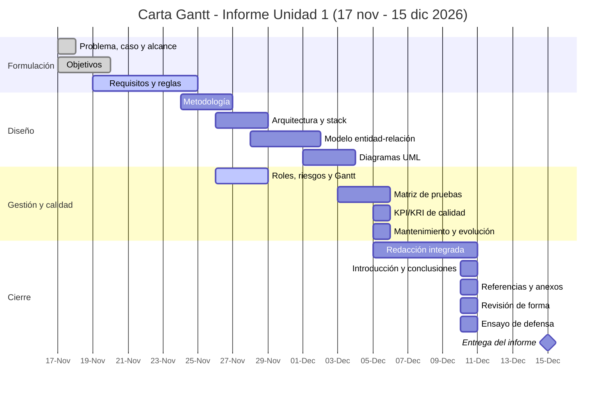

# Cronograma y Carta Gantt

**Estado:** borrador de trabajo. Sustituye al ejemplo de la imagen, que solo ilustra el formato.
**Sección del informe:** III. Desarrollo → Cronograma (y III. Gestión del proyecto).

---

## 1. Supuestos del cronograma

| Parámetro | Valor | Origen |
|---|---|---|
| Integrantes | 4 | Confirmado por el equipo |
| Jornadas semanales | Martes, jueves y sábados 21 y 28 de noviembre y 5 de diciembre | Confirmado por el equipo |
| Horas por jornada | 3 | Confirmado por el equipo |
| Fecha de entrega del informe | 15 de diciembre de 2026 | Transcripción de la clase |
| Inicio de actividades | 17 de noviembre de 2026 | Primera jornada de trabajo |

Las duraciones están expresadas **en días de trabajo**, según lo solicitado en clase, no en semanas.

## 2. Verificación de capacidad

| Concepto | Cálculo | Total |
|---|---|---|
| Jornadas restantes hasta la entrega | 19, 21, 24, 26, 28 nov; 1, 3, 5, 10 dic | 9 jornadas |
| Capacidad por integrante | 9 × 3 h | 27 h |
| Capacidad del equipo | 27 h × 4 integrantes | **108 h** |
| Esfuerzo estimado del informe | Suma de la sección 5 | **106 h** |
| Margen | 108 − 106 | **+2 h (1,9 %)** |

**Conclusión:** la incorporación de las tres jornadas de sábado cierra la brecha y deja el plan en el límite de la capacidad. El margen de dos horas no absorbe un imprevisto: cualquier desvío debe compensarse con trabajo asincrónico o con reducción de alcance, no con horas que no existen.

**Restricción de calendario:** el martes 8 de diciembre es feriado nacional en Chile y no se contabiliza como jornada.

## 3. Jornadas planificadas

| Jornada | Fecha | Foco |
|---|---|---|
| J1 | Mar 17 nov | Formulación del problema, caso simulado y objetivos (ejecutada) |
| J2 | Jue 19 nov | Cierre de objetivos y catálogo de requisitos |
| J3 | Sáb 21 nov | Criterios de aceptación y revisión cruzada del catálogo |
| J4 | Mar 24 nov | Metodología de desarrollo y cierre de requisitos |
| J5 | Jue 26 nov | Arquitectura, stack, roles y riesgos |
| J6 | Sáb 28 nov | Modelo entidad-relación y carta Gantt definitiva |
| J7 | Mar 1 dic | Diagramas UML y revisión del modelo de datos |
| J8 | Jue 3 dic | Cierre de UML y matriz de pruebas |
| J9 | Sáb 5 dic | Indicadores KPI/KRI, mantenimiento e inicio de redacción |
| J10 | Jue 10 dic | Integración, conclusiones, APA, revisión de forma y ensayo |
| — | Mar 15 dic | **Entrega del informe** |

## 4. Responsabilidades

| Código | Rol | Ámbito |
|---|---|---|
| R1 | Coordinación y redacción | Integración del documento, coherencia y formato |
| R2 | Requisitos y gestión | Objetivos, requisitos, riesgos, indicadores |
| R3 | Arquitectura y método | Metodología, arquitectura, referencias |
| R4 | Diseño y pruebas | Modelo entidad-relación, UML, matriz de pruebas |

Cada actividad tiene un responsable único. Los colaboradores apoyan, pero la responsabilidad del entregable recae en la persona indicada.

## 5. Actividades

| N° | Actividad | Resp. | Colabora | Inicio | Fin | Días | Esfuerzo | Estado |
|---|---|---|---|---|---|---|---|---|
| 1 | Formulación del problema, caso simulado y alcance | R1 | — | 17 nov | 17 nov | 1 | 8 h | Hecho |
| 2 | Objetivos general y específicos | R2 | R1 | 17 nov | 19 nov | 2 | 4 h | Hecho |
| 3 | Catálogo de requisitos, reglas y criterios de aceptación | R2 | R1, R4 | 19 nov | 24 nov | 3 | 12 h | Hecho |
| 4 | Metodología de desarrollo y justificación | R3 | R2 | 24 nov | 26 nov | 2 | 4 h | Hecho |
| 5 | Arquitectura, stack tecnológico y despliegue | R3 | R4 | 26 nov | 28 nov | 2 | 8 h | Hecho |
| 6 | Roles, riesgos y carta Gantt definitiva | R2 | R1 | 26 nov | 28 nov | 2 | 6 h | Hecho |
| 7 | Modelo entidad-relación | R4 | R3 | 28 nov | 1 dic | 2 | 8 h | Hecho |
| 8 | Diagramas UML: casos de uso, clases y secuencia | R4 | R1 | 1 dic | 3 dic | 2 | 12 h | Hecho |
| 9 | Estrategia y matriz de pruebas | R4 | R2 | 3 dic | 5 dic | 2 | 8 h | Hecho |
| 10 | Indicadores de calidad KPI/KRI | R2 | R1 | 5 dic | 5 dic | 1 | 6 h | Hecho |
| 11 | Plan de mantenimiento y evolución | R1 | R3 | 5 dic | 5 dic | 1 | 4 h | Hecho |
| 12 | Redacción integrada del Desarrollo | R1 | Todos | 5 dic | 10 dic | 2 | 8 h | Hecho |
| 13 | Introducción y conclusiones (mínimo 2 páginas) | R2 | R1 | 10 dic | 10 dic | 1 | 8 h | Hecho |
| 14 | Referencias APA, anexos y evidencias | R3 | — | 10 dic | 10 dic | 1 | 4 h | Hecho |
| 15 | Revisión de forma: formato, índice, tercera persona | R1 | Todos | 10 dic | 10 dic | 1 | 4 h | Pendiente |
| 16 | Ensayo de defensa ante el docente | Todos | — | 10 dic | 10 dic | 1 | 2 h | Pendiente |
| 17 | **Entrega del informe** | R1 | — | 15 dic | 15 dic | — | — | Hito |

**Esfuerzo total:** 106 horas-persona. La columna *Días* indica jornadas de trabajo, no horas. Varias actividades se ejecutan en paralelo dentro de una misma jornada; el control de capacidad se realiza sobre el total del equipo.

## 6. Carta Gantt

## 7. Hitos de control

| Hito | Fecha | Criterio de cumplimiento |
|---|---|---|
| H1 · Formulación cerrada | 24 nov | Problema, alcance, objetivos y requisitos aprobados por el equipo |
| H2 · Diseño cerrado | 3 dic | Arquitectura, entidad-relación y UML revisados entre pares |
| H3 · Documento completo | 10 dic | Todas las secciones redactadas, sin marcadores pendientes |
| H4 · Entrega | 15 dic | Informe en formato solicitado, índice actualizado |

## 8. Riesgos del cronograma

| ID | Riesgo | Prob. | Impacto | Mitigación | Resp. |
|---|---|---|---|---|---|
| RC-01 | Capacidad insuficiente para el esfuerzo estimado | Cerrado | — | Incorporadas las jornadas de sábado: 108 h disponibles frente a 106 h requeridas | R1 |
| RC-02 | Margen de solo 2 h no absorbe imprevistos | Alta | Alto | Adelantar actividades críticas; si una jornada se pierde, recortar alcance antes que extender fechas | R1 |
| RC-03 | El feriado del 8 de diciembre elimina una jornada | Confirmado | Bajo | Ya descontado del cálculo de capacidad | R1 |
| RC-04 | El docente cuestiona el proyecto en la presentación | Media | Medio | Preparar defensa con alcance y exclusiones justificadas | R2 |
| RC-05 | Requisitos cambian al validar con usuarios reales | Media | Medio | Congelar requisitos el 24 de noviembre; los cambios posteriores van a evolución | R2 |
| RC-06 | Sección del informe sin responsable al momento del cierre | Baja | Alto | Cierre de secciones el 10 de diciembre, sin excepciones | R1 |

## 9. Fuera de este cronograma

El desarrollo y la codificación del sistema corresponden a la etapa posterior a la entrega del informe. Su planificación requiere la devolución del docente y no se fecha en este documento para no comprometer plazos sin respaldo.

## 10. Pendiente de confirmación

1. Identificación de los apartados que el docente marcó en amarillo como primera etapa: el archivo entregado no conserva esos resaltados.

El calendario, las jornadas y las horas por jornada quedan confirmados por el equipo. El esfuerzo estimado se actualiza solo si cambia el alcance.
