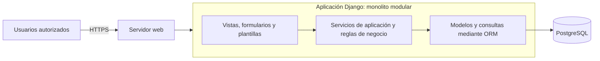

# Arquitectura y diseño de software

**Estado:** propuesta de diseño; Django y PostgreSQL confirmados por el equipo. No implementado.
**Sección del informe:** III. Desarrollo → Arquitectura y diseño de software.
**Caso:** Hospital Público Valle Norte, establecimiento ficticio con una bodega piloto.

## 1. Decisión tecnológica

Se selecciona Django con PostgreSQL. Se propone un **monolito modular con páginas renderizadas en el servidor**, sin aplicación de frontend independiente ni microservicios.

| Componente | Selección | Justificación |
|---|---|---|
| Aplicación | Python y Django | Integra ORM, formularios, plantillas, autenticación y herramientas de administración. |
| Persistencia | PostgreSQL | Permite relaciones, restricciones y transacciones con bloqueo de filas para proteger las existencias. |
| Interfaz propuesta | Plantillas Django, HTML y CSS | Evita mantener una API y un cliente separados en la primera versión. |
| Acceso propuesto | Navegador mediante HTTPS | Centraliza la aplicación sin instalar clientes de escritorio. |
| Administración | Django Admin restringido | Apoya la gestión de usuarios y catálogos; no reemplaza las pantallas operativas de bodega. |

El monolito simplifica las entregas y las transacciones, a cambio de desplegar sus módulos como una sola aplicación. Una API independiente se considera únicamente si aparece una necesidad real de integración.

Las versiones exactas de Python, Django, PostgreSQL y del controlador de base de datos quedan pendientes de verificar y fijar al iniciar la implementación. No se declara una combinación compatible sin esa verificación.

## 2. Vista general propuesta

Las consultas pasan por filtros de autorización. Las entradas, salidas y anulaciones pasan por servicios de aplicación; las vistas y el administrador no modifican directamente los saldos.

## 3. Módulos y responsabilidades

| Módulo propuesto | Responsabilidad | Requisitos principales |
|---|---|---|
| Identidad y acceso | Usuarios, grupos, permisos y asociación con servicios clínicos | RF-01, RF-02, RF-14 |
| Catálogo | Insumos, categorías, unidades, umbrales y control de lote | RF-03, RF-04 |
| Inventario | Entradas, salidas, lotes, existencias y anulaciones | RF-05 a RF-08, RF-10 |
| Consultas y reportes | Alertas, historial, consumo y exportaciones | RF-09, RF-11, RF-12 |
| Auditoría | Eventos sensibles con actor, fecha, operación y resultado | RF-13 |

Los módulos son divisiones internas del mismo proyecto Django, no servicios desplegados por separado. La distribución definitiva en aplicaciones Django se define junto con el modelo de datos.

## 4. Seguridad y límites de las funciones incorporadas

Django proporciona autenticación y permisos asociados a usuarios y grupos (Django Software Foundation, s. f.). La configuración de los roles del proyecto, su matriz de permisos y las restricciones por servicio requieren trabajo específico.

En particular:

- Los permisos estándar por modelo no resuelven por sí solos el acceso exclusivo a los registros de un servicio. Se requieren filtros y comprobaciones del lado del servidor, también en exportaciones y acceso por identificador.
- El historial `LogEntry` del administrador registra altas, cambios y bajas realizados por esa interfaz. No constituye una bitácora integral de operaciones de bodega ni de inicios de sesión.
- RF-13 requiere instrumentar eventos de negocio y autenticación, sin registrar contraseñas ni identificadores de sesión.
- El rol auditor no recibe operaciones de escritura. Los movimientos no se exponen a edición ni eliminación directa en el administrador.
- La expiración por inactividad de RNF-04 requiere una política explícita y su implementación; no se considera resuelta solo por usar sesiones.

El sistema excluye datos de pacientes, pero sí trata datos de funcionarios y usuarios. La ausencia de fichas clínicas no elimina las obligaciones de protección y control de acceso.

## 5. Integridad del inventario

Una validación aislada de la existencia no evita que dos usuarios retiren simultáneamente las últimas unidades. Se propone el siguiente flujo transaccional:

1. Comprobar usuario, permiso, servicio, insumo y cantidad positiva.
2. Abrir una transacción con `transaction.atomic()`.
3. Bloquear los registros de existencia afectados mediante `select_for_update()`, evaluado dentro de la transacción, en un orden consistente.
4. Volver a comprobar el saldo disponible bajo bloqueo y seleccionar lotes elegibles por vencimiento cuando corresponda.
5. Registrar el movimiento, sus detalles, la modificación del saldo y el evento de auditoría asociado.
6. Confirmar todos los cambios juntos; ante un error, revertirlos.

Se proponen restricciones de base de datos sobre cantidades y unicidad, cuya definición se completa con el modelo entidad-relación. El bloqueo de filas y los niveles de aislamiento corresponden a capacidades documentadas del motor (PostgreSQL Global Development Group, s. f.). El bloqueo debe aplicarse en todas las rutas que modifican existencias, no solo en la pantalla principal.

Una anulación conserva el movimiento original y genera una compensación vinculada, sin borrarlo. Antes de compensar se valida que no exista una anulación previa y que el resultado no produzca stock negativo. La reversión de una entrada cuyo stock ya se consumió requiere una política específica, pendiente de validación.

La prueba crítica utiliza PostgreSQL y transacciones concurrentes: con cinco unidades, dos salidas simultáneas de cuatro unidades no pueden aprobarse ambas. Las pruebas de bloqueo se diseñan con `TransactionTestCase`; SQLite no sustituye esa verificación porque `select_for_update()` no tiene efecto allí.

## 6. Despliegue y operación propuestos

El piloto académico utiliza exclusivamente datos simulados. Se propone una instancia de aplicación y una base de datos de acceso restringido; el proveedor de alojamiento y la elección entre infraestructura local o nube permanecen pendientes.

Antes de un despliegue se requieren:

- HTTPS, configuración de producción y secretos fuera del repositorio.
- Usuario de base de datos con privilegios mínimos.
- Respaldo diario, retención definida y ensayo de restauración.
- Registro de errores sin secretos y comprobación del funcionamiento del servicio.

Los objetivos de disponibilidad y recuperación del catálogo de RNF son metas propuestas, no garantías demostradas. Deben contrastarse con el alojamiento y las pruebas operativas.

## 7. Puntos pendientes antes de cerrar el diseño

| Punto | Motivo |
|---|---|
| Existencias por bodega frente a consumo por servicio | Una bodega central no implica mantener stock propio de cada servicio. RF-08 y RF-14 necesitan precisar esa distinción. |
| Solicitud, autorización y entrega | El caso menciona autorización, pero el catálogo no define todo su flujo ni estados. |
| Anulaciones, vencidos y ajustes por conteo | Se requieren reglas para rechazar operaciones inválidas y explicar diferencias sin borrar movimientos. |
| Modelo de datos y UML | Se derivan de los requisitos revisados, no se consideran completos con este documento. |
| Versiones y despliegue | Se verifican antes de implementar; no se instalan herramientas en esta etapa. |

## 8. Fuentes técnicas consultadas

Estas referencias respaldan capacidades del framework, no validan las necesidades del establecimiento ficticio.

- Django Software Foundation. (s. f.). *Using the Django authentication system*. Django documentation. https://docs.djangoproject.com/en/stable/topics/auth/default/
- Django Software Foundation. (s. f.). *Customizing authentication in Django: Handling object permissions*. Django documentation. https://docs.djangoproject.com/en/stable/topics/auth/customizing/#handling-object-permissions
- Django Software Foundation. (s. f.). *The Django admin site: LogEntry objects*. Django documentation. https://docs.djangoproject.com/en/stable/ref/contrib/admin/#logentry-objects
- Django Software Foundation. (s. f.). *QuerySet API reference: select_for_update()*. Django documentation. https://docs.djangoproject.com/en/stable/ref/models/querysets/#select-for-update
- Django Software Foundation. (s. f.). *Database transactions*. Django documentation. https://docs.djangoproject.com/en/stable/topics/db/transactions/
