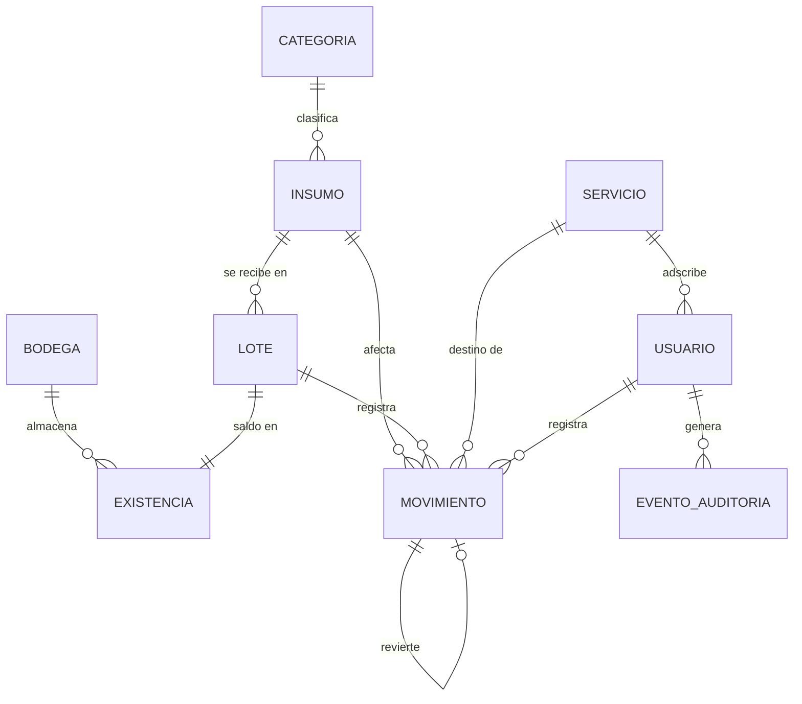

# Modelo de datos y modelo entidad-relación

**Estado:** propuesta de diseño. No implementado.
**Sección del informe:** III. Desarrollo → Diagramas UML y modelo Entidad-Relación.
**Base:** `docs/03-requerimientos.md` y `docs/06-arquitectura.md`.

---

## 1. Decisiones de diseño

Estas decisiones cierran los puntos que la arquitectura dejó abiertos. Cada una indica qué se descartó y por qué.

| ID | Decisión | Alternativa descartada | Motivo |
|---|---|---|---|
| D-01 | **Una sola ubicación de stock.** La bodega piloto mantiene las existencias; los servicios clínicos son destinos de consumo y no tienen saldo propio. | Stock en dos niveles: bodega y servicio | El doble nivel exige transferencias internas, conciliación entre ubicaciones y permisos adicionales. No cabe en el plazo y no es necesario para probar el control de insumos. |
| D-02 | **La salida registra quién autoriza**, sin entidad de solicitud previa. | Flujo digital de solicitud, autorización y entrega con estados | El vale autorizado en papel se representa con el campo `autorizado_por` y el documento de referencia. Un flujo con estados es una funcionalidad completa, no un atributo. Queda como evolución. |
| D-03 | **La anulación no borra: genera un movimiento de reversión** vinculado al original. | Cambiar el estado del movimiento y recalcular el saldo | Si el saldo se recalcula desde el estado, cualquier error de cálculo es invisible. Con reversión, cada cambio de existencia tiene un movimiento que lo explica. |
| D-04 | **El ajuste por conteo es un movimiento propio**, con motivo y permiso de administrador. | Editar el saldo directamente en la tabla de existencias | Editar el saldo destruye la trazabilidad que el sistema pretende entregar. |
| D-05 | **Las existencias vencidas no cuentan como disponibles**, pero se informan por separado. | Sumar todo el saldo y alertar solo por mínimo | Contar insumos vencidos como disponibles produce falsas certezas: el sistema diría que hay stock cuando no se puede usar. |
| D-06 | **Revertir una entrada con stock ya consumido se bloquea**; la corrección se hace por ajuste con motivo. | Permitir la reversión y aceptar saldo negativo transitorio | Un saldo negativo oculta la diferencia real, rompe la restricción RN-12 y deja el inventario en un estado que nadie puede conciliar. El ajuste obliga a dejar constancia de la diferencia. |

## 2. Entidades

| Entidad | Atributos principales | Restricciones |
|---|---|---|
| `Categoria` | id, nombre, activo | `nombre` único |
| `Insumo` | id, codigo, nombre, categoria_id, unidad_medida, stock_minimo, controla_lote, activo | `codigo` único; `stock_minimo ≥ 0` |
| `Lote` | id, insumo_id, numero, fecha_vencimiento, fecha_ingreso | `(insumo, numero)` único |
| `Bodega` | id, nombre, activo | `nombre` único |
| `Existencia` | id, bodega_id, lote_id, saldo | `(bodega, lote)` único; `saldo ≥ 0` |
| `Movimiento` | id, tipo, insumo_id, lote_id, bodega_id, cantidad, servicio_id, registrado_por, autorizado_por, fecha_hora, documento_referencia, motivo, estado, anula_a_id | `cantidad > 0`; `anula_a_id` único |
| `Servicio` | id, nombre, activo | `nombre` único |
| `Usuario` | id, username, nombre, email, servicio_id, activo | Rol mediante grupos de Django |
| `EventoAuditoria` | id, usuario_id, fecha_hora, accion, entidad, objeto_id, resultado, detalle | Sin datos sensibles |

`unidad_medida` se resuelve como dominio cerrado en el insumo (unidad, caja, litro, metro), no como entidad. La conversión entre presentaciones —caja a unidad— queda fuera del alcance de la primera versión.

## 3. Diagrama entidad-relación

### Cardinalidades relevantes

| Relación | Cardinalidad | Lectura |
|---|---|---|
| Insumo – Lote | 1 a N | Un insumo puede recibirse en varios lotes con vencimientos distintos |
| Lote – Existencia | 1 a 1 (una bodega) | El saldo se mantiene por lote y ubicación |
| Movimiento – Movimiento | 1 a 0..1 | Un movimiento puede ser revertido por uno solo; una reversión apunta a un original |
| Servicio – Movimiento | 1 a N | El servicio acumula consumos, no existencias |
| Usuario – Movimiento | 1 a N | Todo movimiento tiene un responsable identificado |

## 4. Cálculo del saldo

Cada movimiento tiene un efecto sobre el saldo, definido por su tipo:

| Tipo | Efecto | Uso |
|---|---|---|
| `ENTRADA` | +cantidad | Recepción de bodega |
| `SALIDA` | −cantidad | Entrega a un servicio |
| `AJUSTE` | ±cantidad según el conteo | Corrección autorizada por diferencias |
| `REVERSION` | Opuesto al movimiento que anula | Compensación de un movimiento anterior |

**Regla de cálculo:** el saldo de una existencia es la suma del efecto de **todos** sus movimientos, sin filtrar por estado.

Esta regla evita el error más común de este modelo: si además se excluyeran los movimientos anulados, la reversión descontaría dos veces. El campo `estado` (`VIGENTE` o `ANULADO`) sirve para reportes y para impedir una segunda anulación, no para calcular el saldo.

## 5. Reglas de selección y alertas

**FEFO (RN-05).** Los lotes elegibles para una salida son aquellos con saldo mayor que cero y no vencidos. Se ordenan por fecha de vencimiento ascendente y, en empate, por fecha de ingreso. Los insumos sin control de lote operan con un lote único implícito.

**Alerta de stock mínimo (RN-03 y D-05).** Se suman los saldos de los lotes **no vencidos**. Si el total es menor o igual al stock mínimo, el insumo aparece en la alerta. El saldo vencido se informa en un reporte aparte.

**Próximos vencimientos (RF-10).** Se listan los lotes con saldo mayor que cero y vencimiento dentro del horizonte configurado.

**Stock no negativo (RN-12).** Se garantiza con la restricción `saldo ≥ 0` en la base de datos, además de la validación en la aplicación. La restricción es la última línea de defensa si una ruta de código omite la comprobación.

## 6. Restricciones de integridad

| Restricción | Implementación |
|---|---|
| Código de insumo único | Índice único |
| Número de lote único por insumo | Índice único compuesto |
| Saldo no negativo | `CHECK (saldo >= 0)` |
| Cantidad positiva | `CHECK (cantidad > 0)` |
| Salida con servicio y autorizante | `CHECK` condicional por tipo |
| Una sola reversión por movimiento | Índice único en `anula_a_id` |
| Insumo con control de lote exige lote | Validación de aplicación al registrar el movimiento |
| Insumo inactivo no admite movimientos | Validación de aplicación |
| Reversión de una entrada con lotes ya consumidos | Validación de aplicación (D-06): se rechaza y se ofrece ajuste por conteo |

Las dos últimas no se expresan como restricción de base de datos porque dependen de otro registro. Se documentan como validación obligatoria en el servicio de aplicación.

## 7. Índices y concurrencia

| Índice | Motivo |
|---|---|
| `Existencia (bodega, lote)` único | Localizar el saldo y bloquearlo con precisión |
| `Movimiento (insumo, fecha_hora)` | Historial por insumo |
| `Movimiento (servicio, fecha_hora)` | Consumo por servicio |
| `Lote (insumo, fecha_vencimiento)` | Selección FEFO |
| `EventoAuditoria (fecha_hora)` | Consulta de auditoría |

El bloqueo de la sección 5 de la arquitectura se aplica sobre las filas de `Existencia`, siempre en orden de identificador para evitar interbloqueos entre transacciones concurrentes. La creación de una existencia nueva compite contra el índice único: se resuelve reintentando la lectura tras el conflicto, no creando filas duplicadas.

## 8. Trazabilidad requisito → entidad

| Requisito | Entidades |
|---|---|
| RF-03, RF-04 | `Insumo`, `Categoria` |
| RF-05 | `Movimiento` (entrada), `Lote`, `Existencia` |
| RF-06, RN-02 | `Movimiento` (salida), `Servicio`, `Usuario` |
| RF-07, RN-09 | `Movimiento` (reversión), `anula_a` |
| RF-08, RF-09, RF-14 | `Existencia`, `Movimiento`, `Servicio` |
| RF-10 | `Lote`, `Existencia` |
| RF-11 | `Movimiento`, `Servicio`, `Usuario` |
| RF-13 | `EventoAuditoria` |

## 9. Pendiente

1. Equivalencia entre presentaciones de compra y unidades de consumo: fuera del alcance de la primera versión, se registra como evolución.
2. Política para revertir una entrada cuyo stock ya fue consumido: **resuelta en D-06**, se bloquea y se exige ajuste por conteo.
3. Horizonte de alerta de vencimientos: **resuelto en RN-14**, 30 días, configurable.
4. Diagramas UML de casos de uso, clases y secuencia: corresponden a la actividad siguiente y derivan de este modelo.
