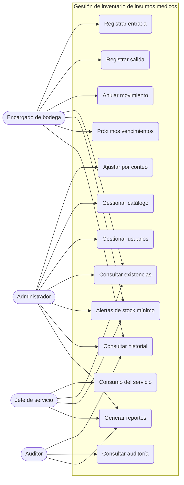
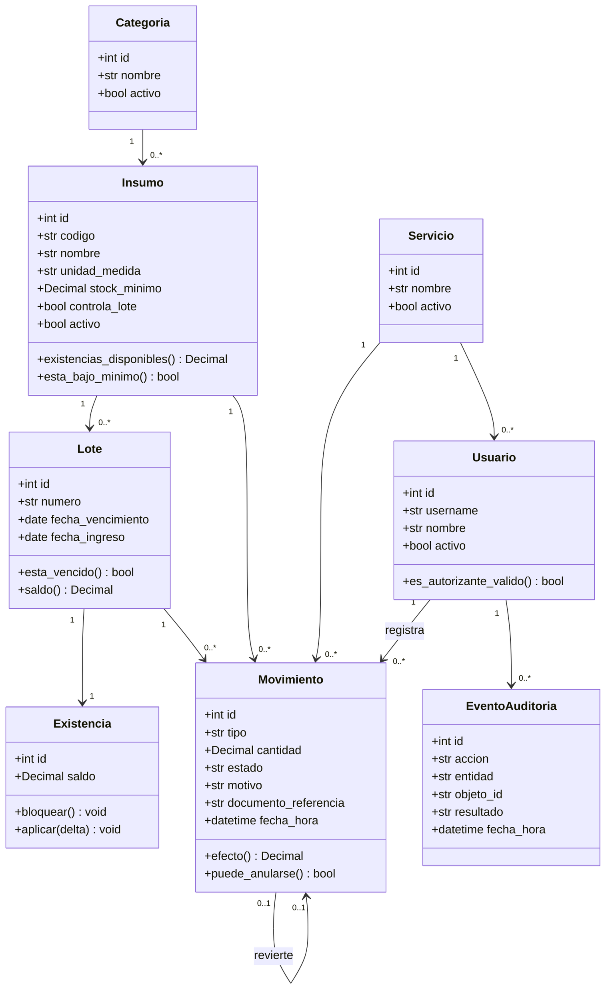
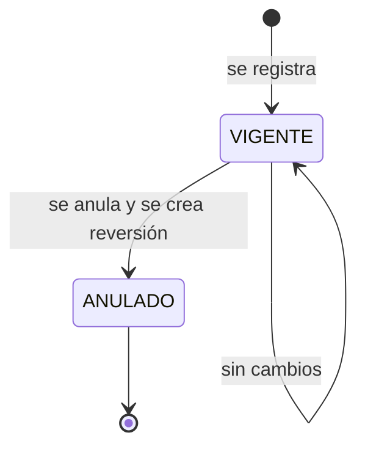
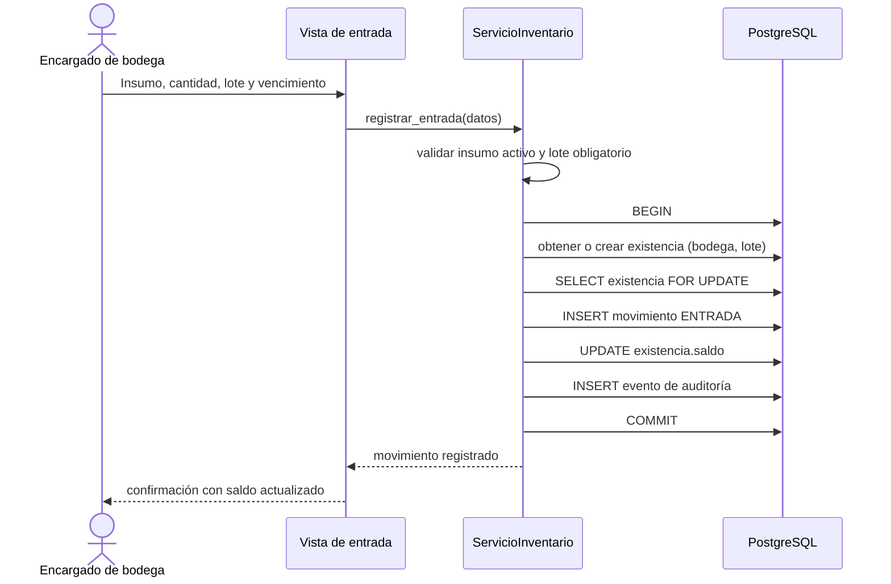
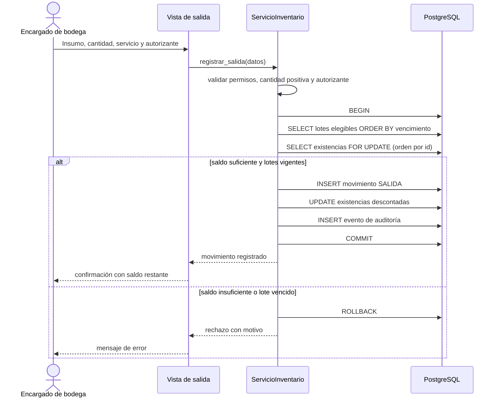
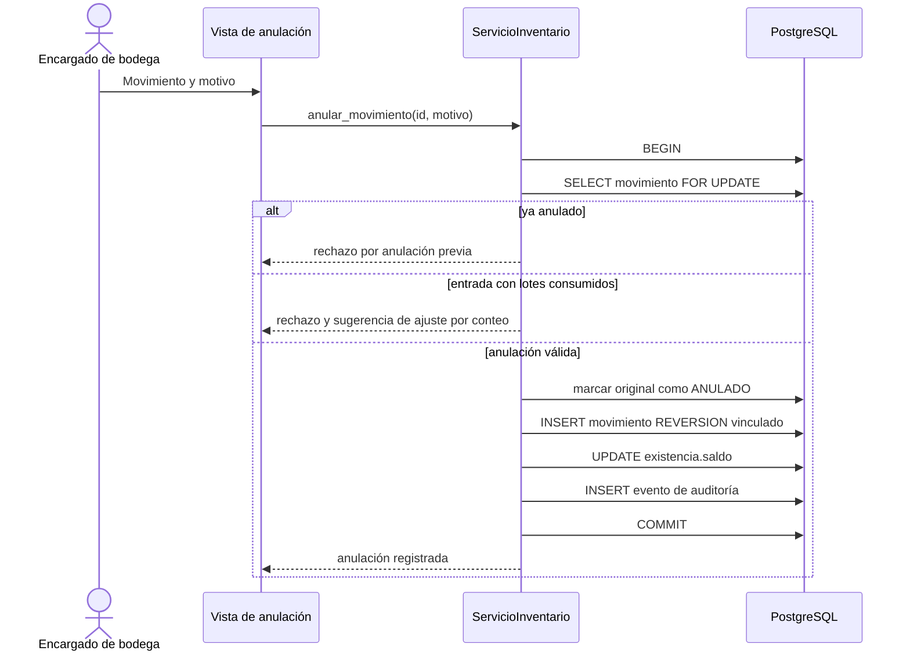

# Diagramas UML

**Estado:** propuesta de diseño. No implementado.
**Sección del informe:** III. Desarrollo → Diagramas UML y modelo Entidad-Relación.
**Deriva de:** `docs/03-requerimientos.md` y `docs/07-modelo-datos.md`. El modelo entidad-relación se encuentra en ese documento; aquí se presentan casos de uso, clases, estados y secuencia.

---

## 1. Actores y casos de uso

| ID | Caso de uso | Actores | Requisitos |
|---|---|---|---|
| CU-01 | Registrar entrada de insumos | Encargado de bodega | RF-05 |
| CU-02 | Registrar salida a un servicio | Encargado de bodega | RF-06, RN-01, RN-02 |
| CU-03 | Anular movimiento | Encargado de bodega | RF-07, RN-09, RN-13 |
| CU-04 | Ajustar existencia por conteo | Administrador | RN-11 |
| CU-05 | Consultar existencias | Todos los roles | RF-08 |
| CU-06 | Consultar alertas de stock mínimo | Todos los roles | RF-09, RN-03 |
| CU-07 | Consultar próximos vencimientos | Todos los roles | RF-10 |
| CU-08 | Consultar historial de movimientos | Administrador, bodega, auditor | RF-11 |
| CU-09 | Consultar consumo del servicio | Jefe de servicio | RF-14 |
| CU-10 | Gestionar catálogo de insumos | Administrador | RF-03, RF-04 |
| CU-11 | Gestionar usuarios y roles | Administrador | RF-01, RF-02 |
| CU-12 | Consultar auditoría | Auditor | RF-13 |
| CU-13 | Generar reportes | Administrador, jefe de servicio, auditor | RF-12 |

## 2. Diagrama de casos de uso

## 3. Diagrama de clases

Los métodos del diagrama representan comportamiento del dominio. `Existencia.bloquear()` corresponde al bloqueo de fila descrito en la arquitectura y no se invoca fuera de una transacción.

## 4. Diagrama de estados del movimiento

Un movimiento anulado no vuelve a estado vigente. Si la anulación fue un error, se registra un movimiento nuevo; no se reescribe la historia.

## 5. Secuencia: registrar entrada

## 6. Secuencia: registrar salida con FEFO y control de concurrencia

La comprobación de saldo ocurre **después** de bloquear las filas. Verificar antes de bloquear deja una ventana en la que dos usuarios pueden aprobar la misma unidad disponible.

## 7. Secuencia: anular movimiento

## 8. Trazabilidad caso de uso → requisito

| Caso de uso | Reglas aplicadas | Criterio de aceptación asociado |
|---|---|---|
| CU-02 | RN-01, RN-02, RN-05 | Rechazo de salida sobre el stock y registro de autorizante |
| CU-03 | RN-06, RN-09, RN-13 | Reversión conservando el original y bloqueo de anulación inválida |
| CU-04 | RN-11 | Ajuste con motivo y rol autorizado |
| CU-06 | RN-03, D-05 | Alerta considera solo lotes no vencidos |
| CU-09 | RF-14 | El jefe de servicio no accede a otras unidades |

## 9. Pendiente

- Diagrama de despliegue: depende de la decisión de alojamiento, aún abierta.
- Diagrama de componentes: se deriva de la arquitectura y no aporta información adicional a la vista general ya documentada.
- Validación de los nombres de casos de uso con el docente antes del cierre del diseño.
